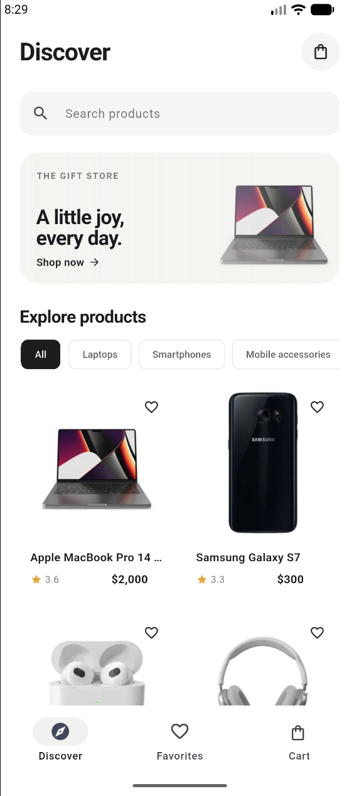
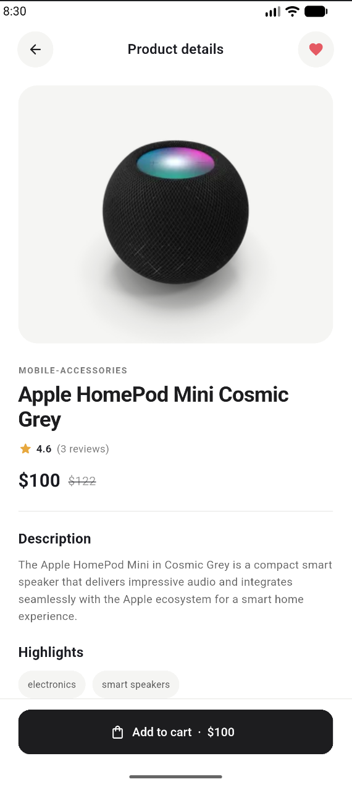
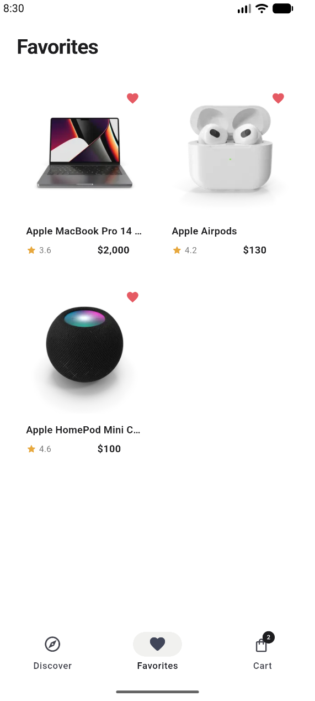
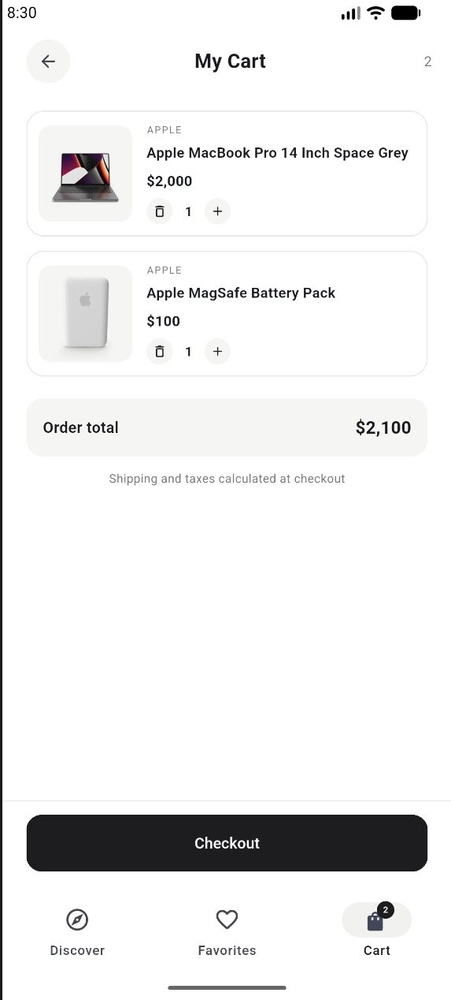

# Discover

Flutter ile geliştirilmiş mobil ürün kataloğu. Ürünler DummyJSON’dan yüklenir; bağlantı olmadığında uygulamadaki yerel katalog kullanılır.

## Özellikler

- Ürün arama ve kategori filtreleme
- Ürün detayları ve favoriler
- Sepet, adet güncelleme ve örnek ödeme akışı

Ödeme işlemi demo amaçlıdır; gerçek ödeme alınmaz.

## Sürümler

- Flutter 3.50.0 (stable)
- Dart 3.14.0

## Çalıştırma

Proje klasöründe:

```bash
flutter pub get
flutter run
```

## Ekran görüntüleri

### Ana sayfa



### Ürün detayı



### Favoriler



### Sepet


